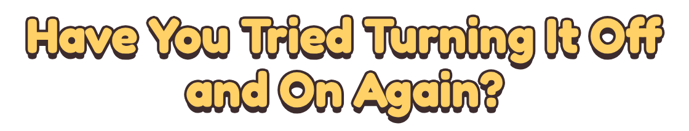
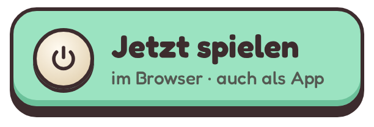
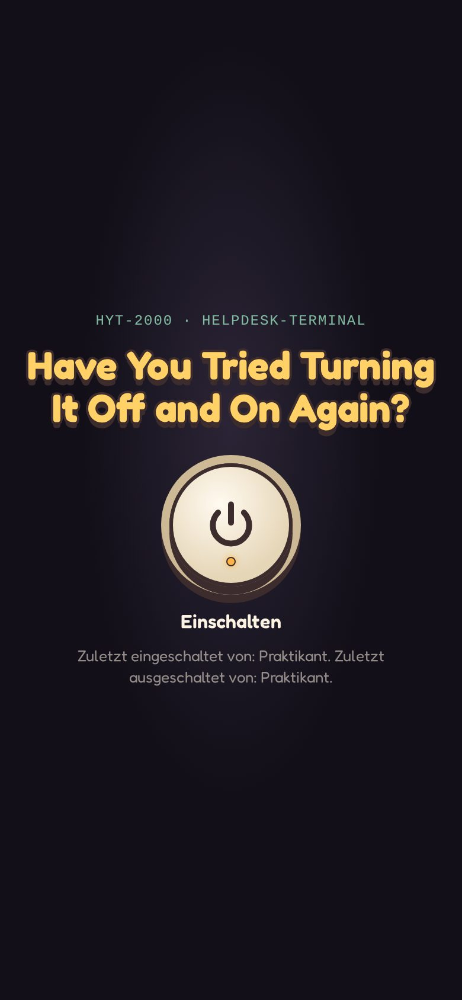
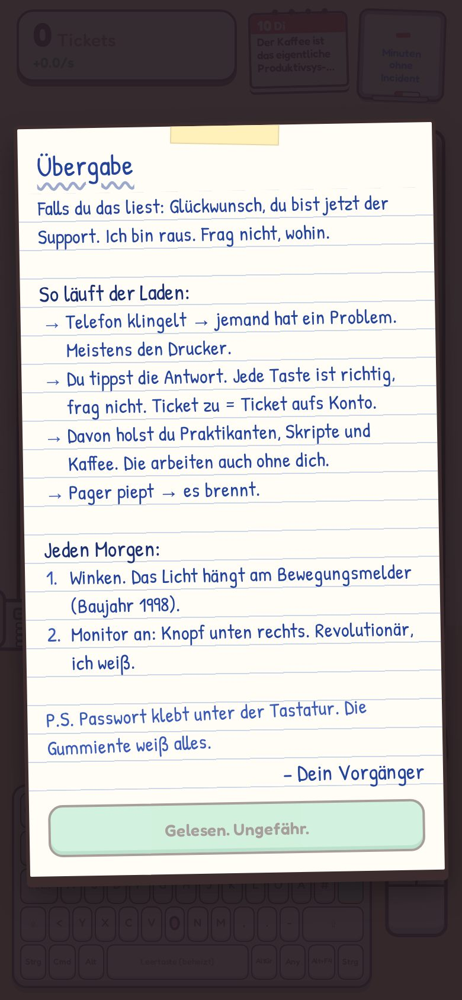
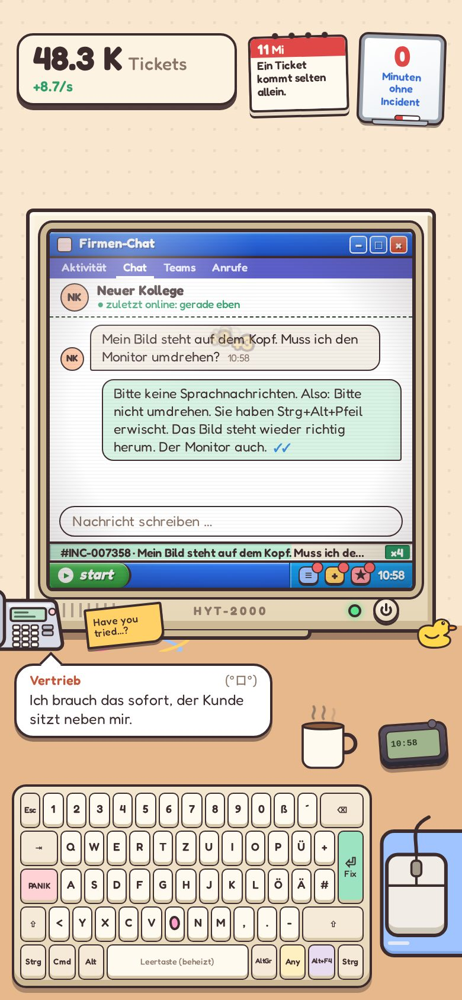
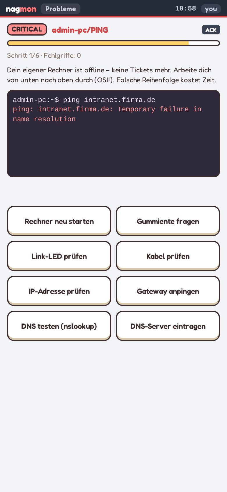
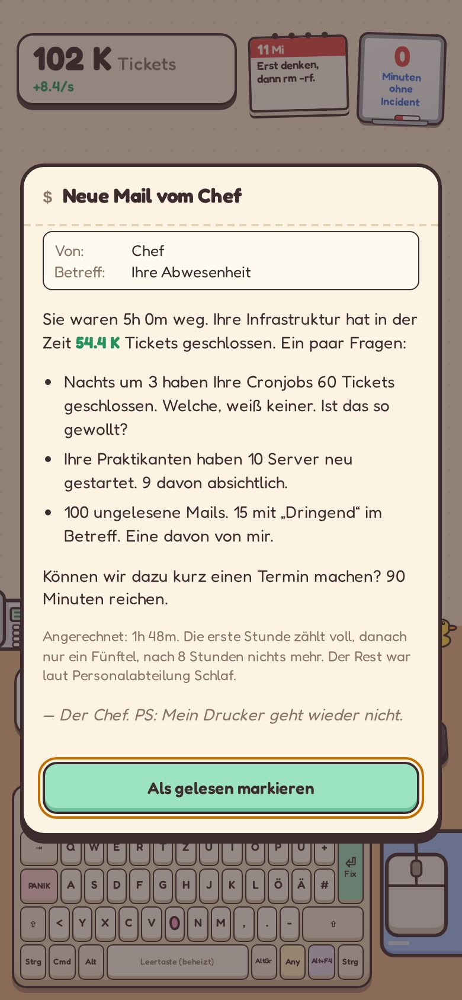
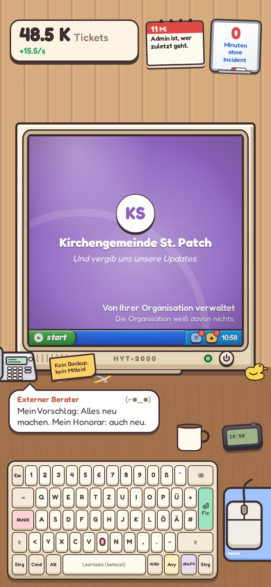

<!-- Wortmarke aus dem Startbildschirm des Spiels -->
<p align="center">
  
</p>

<p align="center">
  
  
  
  <a href="LICENSE"></a>
</p>

<p align="center">
  Incremental-Game im IT-Support: Du übernimmst den Helpdesk deines Vorgängers,
  tippst <b>Tickets</b> weg, bis Praktikanten, Skripte und Server die Arbeit machen – und der Pager trotzdem piept.
</p>

<p align="center">
  <a href="https://dvnkln.github.io/haveyoutried/"></a>
</p>
<p align="center"><sub>Immer der aktuelle Prototyp – am besten auf dem Handy.</sub></p>

## ✨ Features

- ⌨️ **Tickets wegtippen** – jede Taste ist richtig, und im Fenster entsteht eine echte Antwort auf das Anliegen am Telefon: per Mail, im Ticketsystem, im Terminal, im Chat oder per Fernwartung.
- 🏗️ **Infrastruktur aufbauen** – Praktikanten, Bash-Skripte, Cronjobs, Ansible, Kubernetes und KI-Agents schließen Tickets auch dann, wenn du gerade nicht spielst.
- 🚨 **Incidents als Minispiele** – RAID retten, Spam sortieren, Dienste neu starten, Logs durchsuchen, Netzwerk prüfen, Patchkabel stecken.
- 🏢 **Karriere** – kündigen, Berufserfahrung mitnehmen und neu anfangen: 26 Firmen mit eigenen Eigenheiten, dazu Achievements.
- 📱 **Fürs Handy gemacht** – Hochformat, als App installierbar und offline spielbar.
- 🤓 **Viel Humor** – voller Anspielungen auf die Klassiker des IT-Humors, witzig auch ohne sie zu kennen (siehe [Vorbilder](#-vorbilder)).

## 📱 Bildschirmfotos

|                                 Start                                  |                         Zettel vom Vorgänger                          |                                 Schreibtisch                                  |
| :--------------------------------------------------------------------: | :-------------------------------------------------------------------: | :---------------------------------------------------------------------------: |
|  |  |  |

|                                 Incident                                  |                               Mail vom Chef                                |                            Firmen-Hintergrundbild                            |
| :-----------------------------------------------------------------------: | :------------------------------------------------------------------------: | :--------------------------------------------------------------------------: |
|  |  |  |

## 🛠️ Selbst bauen

Zum Spielen brauchst du nichts davon – nur wenn du am Spiel etwas ändern möchtest. Voraussetzung: [Node.js](https://nodejs.org) 22.12 oder neuer.

```bash
npm install
npm run dev          # Entwicklungsserver, Adresse steht in der Ausgabe (auch im LAN)
```

Weitere Befehle:

```bash
npm test             # Unit-Tests (vitest): Spiellogik, Balancing, Inhalte
npm run build        # Typprüfung und Produktions-Build nach dist/
npm run preview      # den Build lokal ausprobieren

npx playwright install chromium   # einmalig, für die Browser-Tests
npm run test:e2e     # Playwright im 360-px-Hochformat, eigener Test-Build (?incident=…, ?boot)
```

Optional: `npm run vorschau` baut das Spiel und stellt es dauerhaft per nginx-Container bereit (Docker nötig), standardmäßig auf Port 8081 im ganzen Netzwerk. Einen anderen Port oder eine feste Adresse setzt `VORSCHAU_BIND` (z. B. `9000` oder `192.168.1.20:9000`), auch dauerhaft in einer lokalen Datei `werkzeug/vorschau.env`.

Wo was liegt:

- ⚖️ Balancing: `src/config.ts`
- 💬 Texte und Humor: `src/content/`
- ⚙️ Spiellogik ohne DOM: `src/core/`
- 🎨 Oberfläche: `src/ui/` – Schreibtisch `desk.ts`, Arbeitsfenster `work.ts`, Licht und Monitor `power.ts`, Startablauf `boot.ts`, Klänge `audio.ts` und `ambience.ts`; Theme und Comic-Look in `src/styles/main.css`

## 🙏 Mitwirkende

Schriften: [Fredoka](https://fonts.google.com/specimen/Fredoka) (The Fredoka Project Authors) und [Patrick Hand](https://fonts.google.com/specimen/Patrick+Hand) (Patrick Wagesreiter), beide unter der SIL Open Font License 1.1 – siehe [`src/assets/fonts/OFL.txt`](src/assets/fonts/OFL.txt).

Alles andere – Schreibtisch, Requisiten, Hintergrundbilder, Symbole und sämtliche Klänge – ist im Code gezeichnet bzw. im Browser erzeugt.

## 💾 Vorbilder

Das Spiel ist die Liebeserklärung eines Fans an den IT-Humor und steckt voller Anspielungen darauf:
[The IT Crowd](https://www.channel4.com/programmes/the-it-crowd) – von dort stammt auch der Titel –,
die [BOFH](https://www.theregister.com/data_centre/bofh/)-Geschichten von Simon Travaglia,
[xkcd](https://xkcd.com) von Randall Munroe, Dilbert von Scott Adams, Stromberg, Silicon Valley und allerlei Internet-Folklore.

Bis auf den Titel und ein paar geflügelte Worte ist alles in eigenen Worten geschrieben, ohne Bilder oder Logos der Originale. Das Spiel steht in keiner Verbindung zu den Urhebern oder Rechteinhabern dieser Werke.

## 🤖 Mit KI gebaut

Das Spiel entsteht mit starker KI-Unterstützung: Der größte Teil des Codes, der Inhalte und der Texte stammt von [Claude Code](https://claude.com/claude-code), dem Programmierassistenten von Anthropic.

Mein Teil ist die Produktseite: was das Spiel sein soll, wie es aussehen, klingen und sich anfühlen soll, welcher Humor passt und welche Richtung es nimmt. Ich spiele jeden Stand auf dem Handy, gebe Rückmeldung und entscheide, was bleibt. Die KI setzt das in Code um, prüft es mit Tests, Bildschirmfotos und Simulationen fürs Balancing und dokumentiert es.

Wenn dir ein Fehler oder etwas Seltsames im Code auffällt, freue ich mich über ein [Issue](https://github.com/dvnkln/haveyoutried/issues).

## 📜 Lizenz

Copyright (C) 2026 Devin Klein

[GNU AGPL v3](LICENSE) – du darfst das Spiel frei nutzen, verändern und weitergeben. Wer eine veränderte Fassung weitergibt oder anderen über das Netz anbietet, muss den Quellcode seiner Fassung unter derselben Lizenz offenlegen.

**Zum Namen:** Der Titel ist ein Zitat aus The IT Crowd und gehört niemandem allein – auch mir nicht. Wenn du eine eigene Fassung veröffentlichst, gib ihr bitte einen eigenen Namen und ein eigenes Symbol, damit niemand sie für die offizielle Version hält.

Privates Projekt, ohne Gewähr und ohne Support – wenn es dir trotzdem Spaß macht, umso besser.
